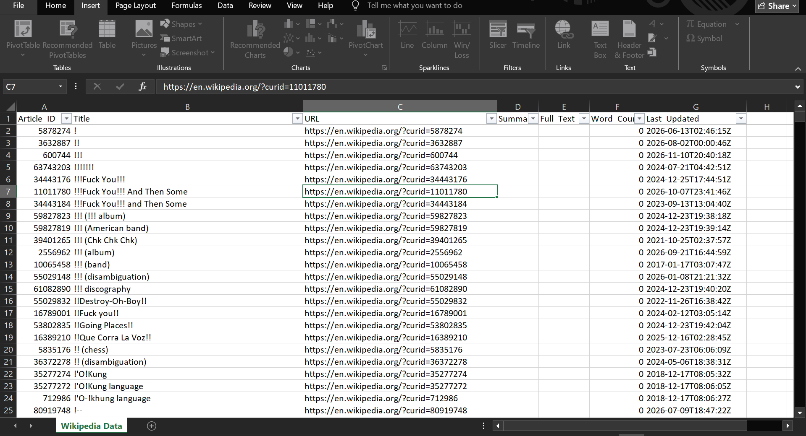

# Wikipedia Article Scraper

A Python-based web data extraction project that collects article information from Wikipedia using the MediaWiki API and exports the extracted dataset into CSV and Excel formats.

## Features

- Extracts up to 1,000 Wikipedia articles.
- Retrieves article titles and page IDs.
- Extracts full article text and introductory summaries.
- Collects article URLs and last modification timestamps.
- Calculates article word counts.
- Filters empty and short articles.
- Removes duplicate records.
- Exports data into CSV format.
- Converts CSV datasets into formatted Excel workbooks.

## Technologies Used

- Python
- Requests
- Pandas
- tqdm
- OpenPyXL
- Wikipedia MediaWiki API

## Installation

Clone the repository:

```bash
git clone YOUR_REPOSITORY_URL
```

Navigate to the project folder:

```bash
cd Wikipedia-Article-Scraper
```

Create a virtual environment:

```bash
python -m venv .venv
```

Activate it on Windows:

```bash
.venv\Scripts\activate
```

Install dependencies:

```bash
pip install -r requirements.txt
```

## Usage

Run the scraper:

```bash
python scraper2.py
```

Convert the CSV dataset to Excel:

```bash
python csv_to_excel.py
```

## Output

The project generates:

- `wikipedia_articles.csv`
- `wikipedia_articles.xlsx`

These files contain the extracted article information.
### Excel Dataset Preview

The following screenshot demonstrates the generated
Wikipedia dataset in Microsoft Excel.


## Data Source

Wikipedia — MediaWiki Action API

https://www.mediawiki.org/wiki/API:Main_page

## Project Purpose

This project was developed for educational and research purposes to practice Python programming, API integration, data extraction, data cleaning, and dataset generation.

## Author

Muhammad Haroon Shah

BS Software Engineering Student